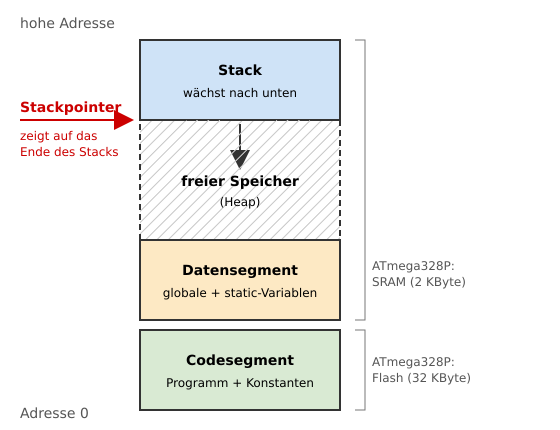
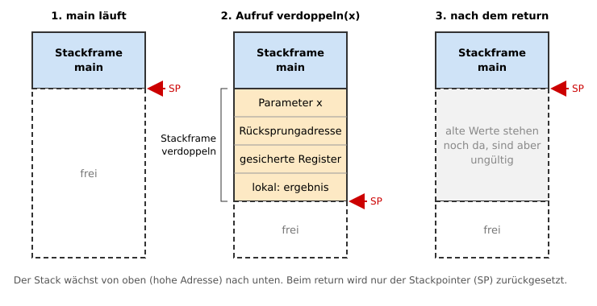
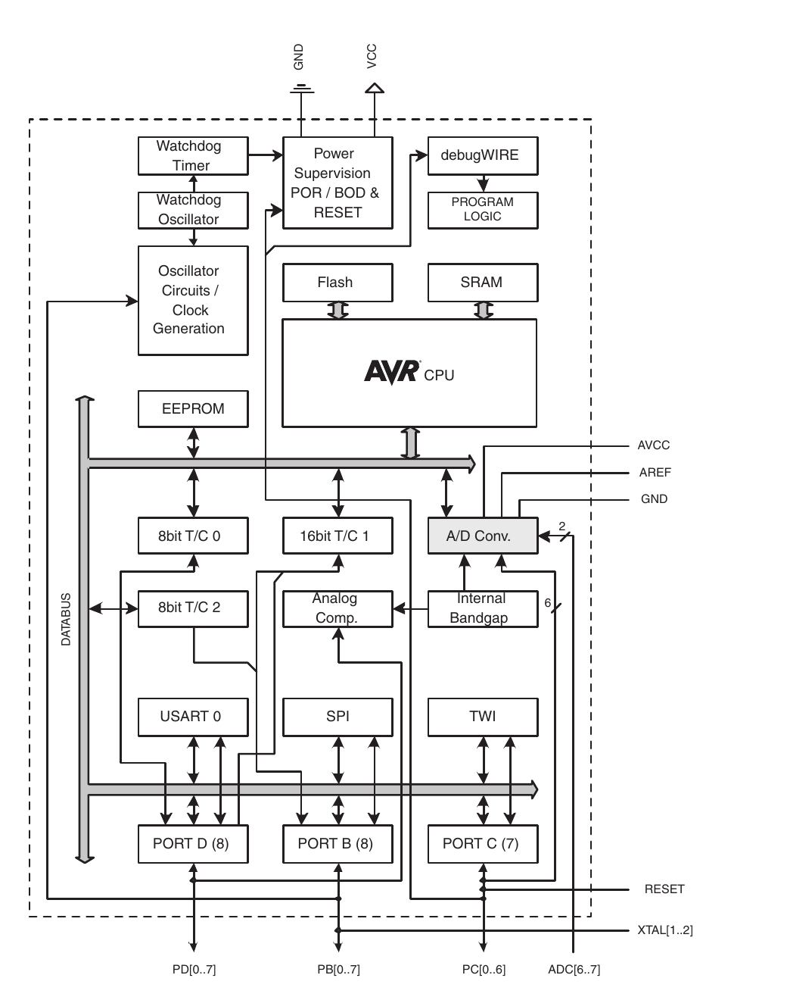
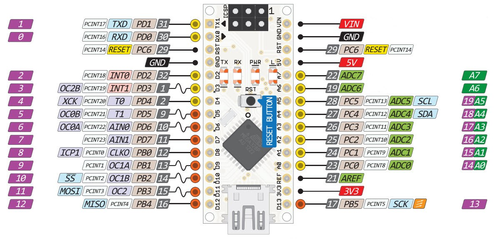
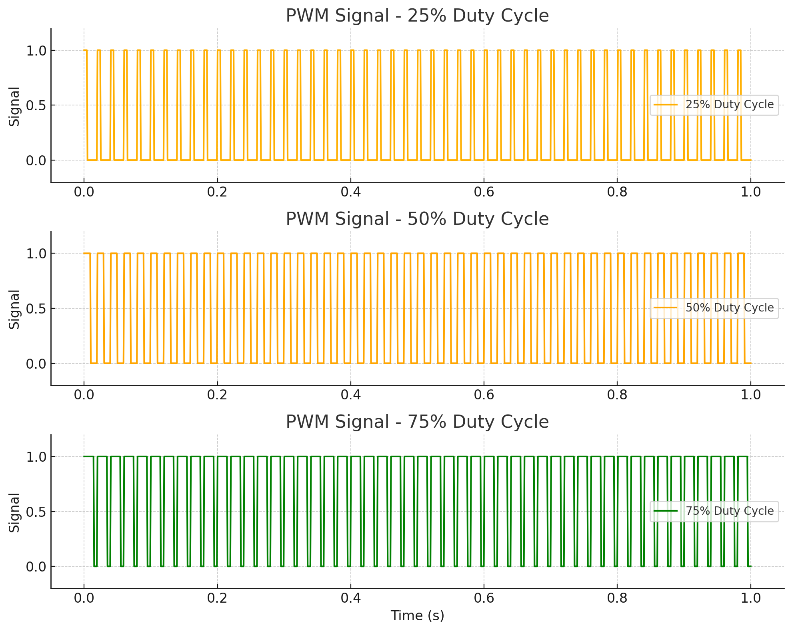

# Systemnahe Programmierung

Vorlesungsskript – C und ATmega328P (Arduino Nano) ohne Arduino-Bibliothek · Joachim Wagner · DHBW Mannheim

# Vorwort: So arbeitest du mit diesem Skript

Dieses Skript begleitet die Vorlesung Systemnahe Programmierung. Du lernst, einen Mikrocontroller direkt zu programmieren: ohne Arduino-Funktionen wie `digitalWrite()`, dafür mit den echten Hardwareregistern des Chips. Das ist die Grundlage für Treiber, Betriebssysteme und eingebettete Systeme.

Das Skript hat zwei Teile. **Teil A** erklärt die Sprache C und den Speicher eines Programms, ganz ohne Hardware. Du kannst ihn am PC nachvollziehen. **Teil B** führt Schritt für Schritt zum Mikrocontroller. Zu jedem Kapitel in Teil B gibt es ein fertiges Beispielprojekt im Ordner `clion/`.

| Kapitel | Thema | Projekt / Kernidee |
|---|---|---|
| 9 | Ausgabe: LED blinkt | `01_Blink` – Datenrichtungsregister, PORT-Register |
| 10 | Eingabe: Taster (Polling) | `02_EingabeMitPolling` – PIN-Register, Pull-up |
| 11 | Interrupts | `03_Interrupt` – ISR, `sei()`, `volatile` |
| 12 | Timer und Frequenz | `04_Timer_undFrequenz` – CTC-Modus, Vorteiler |
| 13 | PWM | `05_PWM` – Fast-PWM, Duty-Cycle |
| 14 | Serielle Schnittstelle | `06_Serielle_Schnittstelle` – USART, Baudrate |
| 15 | Analoge Eingänge | `07_AnalogerEingang`, `08_AnalogReader2Kanal` (je auch als `_ohneAtomic`) – ADC per Interrupt |

> **Merke:** Du lernst Mikrocontroller nur durch Ausprobieren. Ändere in jedem Projekt Werte, flashe neu und beobachte, was passiert. Kaputtmachen kannst du dabei nichts: Der Nano lässt sich jederzeit neu programmieren.

# Teil A: Grundlagen der Sprache C

In diesem Teil geht es nur um C. Alles hier gilt genauso für den PC wie für den Mikrocontroller. Wir schauen besonders darauf, **wo** im Speicher Dinge liegen, denn das ist auf einem Controller mit 2 KByte Arbeitsspeicher entscheidend.

## 1 Vom Quelltext zum Programm

**Lernziele**

- Du kannst die Schritte Präprozessor, Compiler, Linker nennen.
- Du weißt, was ein Cross-Compiler ist.
- Du kannst `#include` und `#define` erklären.

Ein C-Programm steht in Textdateien (`.c` und `.h`). Bevor es laufen kann, sind vier Schritte nötig:

- **Präprozessor:** ersetzt `#include` und `#define` rein textuell. Aus `#define F_CPU 16000000UL` wird überall im Text die Zahl 16000000UL.
- **Compiler:** übersetzt jede `.c`-Datei einzeln in Maschinencode (`.o`-Datei).
- **Linker:** verbindet alle `.o`-Dateien und Bibliotheken zu einer Datei (`.elf`).
- **Hex-Datei:** aus der `.elf` wird eine `.hex`-Datei mit dem reinen Programmcode. Diese Datei wird auf den Chip geladen.

Auf dem PC läuft das entstandene Programm auf demselben Rechner, auf dem es übersetzt wurde. Beim Mikrocontroller übersetzen wir auf dem PC für einen **anderen Prozessor**. Das nennt man **Cross-Compiler**. Bei uns heißt er `avr-gcc`.

**Ein minimales C-Programm**

```c
#include <stdio.h>          // Präprozessor holt den Inhalt der Datei
#define ANZAHL 3            // reine Textersetzung

int main(void)
{
    printf("Hallo\n");         // am PC; auf dem Nano gibt es kein printf-Terminal
    return 0;
}
```

> **Typischer Fehler:** Ein `#define` ist keine Variable und kennt keine Typen. `#define QUADRAT(x) x*x` liefert für `QUADRAT(2+1)` den Wert 2+1*2+1 = 5, nicht 9. Setze in Makros immer Klammern: `#define QUADRAT(x) ((x)*(x))`.

## 2 Datentypen mit fester Breite

**Lernziele**

- Du weißt, warum `int` nicht überall gleich groß ist.
- Du wählst `uint8_t`, `int16_t` usw. bewusst aus.

Der Standard schreibt für `int` nur eine Mindestbreite vor. Auf dem PC hat `int` meist 32 Bit, mit `avr-gcc` auf dem ATmega328P nur **16 Bit**. Code, der auf dem PC funktioniert, kann auf dem Controller überlaufen. Deshalb verwenden wir in der Systemprogrammierung die Typen aus `<stdint.h>`, deren Breite im Namen steht.

| Typ | Bits | Wertebereich | Typische Verwendung |
|---|---|---|---|
| `uint8_t` | 8 | 0 … 255 | ein Register, ein Byte, ein Zähler bis 255 |
| `int8_t` | 8 | −128 … 127 | kleine vorzeichenbehaftete Werte |
| `uint16_t` | 16 | 0 … 65535 | ADC-Wert (0…1023), Timer 1 |
| `int16_t` | 16 | −32768 … 32767 | Messwerte mit Vorzeichen |
| `uint32_t` | 32 | 0 … 4 294 967 295 | Zeitstempel, große Zähler |

Regel für dieses Skript: Wo es sinnvoll ist, steht ein Typ mit fester Breite statt `int`. Nur `main` behält `int` als Rückgabetyp, weil der Standard das so verlangt. Zeichenketten bleiben `char`.

> **Merke:** Ein Register des ATmega328P ist 8 Bit breit. Ein `uint8_t` passt genau hinein und erzeugt den kürzesten und schnellsten Code. 16-Bit-Rechnungen brauchen auf dem 8-Bit-Controller mindestens doppelt so viele Befehle.

## 3 Speicheraufbau und Speicherorte von Variablen

**Lernziele**

- Du beschreibst den vereinfachten Speicheraufbau mit Codesegment, Datensegment, freiem Speicher (Heap) und Stack.
- Du nennst die Aufgabe jedes Bereichs.
- Du unterscheidest globale, modulglobale (`static`) und lokale Variablen und weißt, wo sie liegen.
- Du erklärst, was `volatile` bewirkt.

### 3.1 Vereinfachter Speicheraufbau

Den Speicher, der einem Programm zur Verfügung steht, teilen wir vereinfacht in vier Bereiche auf:



- **Codesegment:** enthält den Maschinencode des Programms und die Konstanten. Der Inhalt steht fest, sobald das Programm übersetzt ist, und ändert sich zur Laufzeit nicht.
- **Datensegment:** enthält die globalen und die mit `static` deklarierten Variablen. Sie bekommen beim Programmstart einen festen Platz und behalten ihn, solange das Programm läuft.
- **Freier Speicher (Heap):** der Rest zwischen Datensegment und Stack. Aus ihm kann das Programm zur Laufzeit mit `malloc()` Speicher anfordern und mit `free()` zurückgeben. Gleichzeitig ist er die Reserve, in die der Stack hineinwächst.
- **Stack:** nimmt bei jedem Funktionsaufruf einen **Stackframe** auf (Rücksprungadresse, Parameter, lokale Variablen) und gibt ihn beim Verlassen der Funktion wieder frei. Er wächst von den hohen Adressen nach unten. Der **Stackpointer** zeigt immer auf das aktuelle Ende des Stacks.

Beim ATmega328P liegt das Codesegment im Flash-Speicher (32 KByte). Datensegment, freier Speicher und Stack teilen sich den SRAM (2 KByte).

| Bereich | Inhalt | Lebensdauer | Beim ATmega328P in |
|---|---|---|---|
| Codesegment | Programmcode, Konstanten | fest | Flash (32 KByte) |
| Datensegment | globale und `static`-Variablen | gesamte Programmlaufzeit | SRAM |
| freier Speicher (Heap) | mit `malloc()` angeforderter Speicher | bis `free()` | SRAM |
| Stack | Stackframes: Rücksprungadressen, Parameter, lokale Variablen | bis zum Ende der Funktion | SRAM |

> **Merke:** Stack und Heap wachsen aufeinander zu. Wird der Stack zu groß, überschreibt er den Heap und das Datensegment. Diesen Stacküberlauf meldet der Mikrocontroller nicht, das Programm verhält sich dann einfach falsch.

### 3.2 Wo liegt was?

```c
uint16_t zaehler = 0;              // global: Datensegment, lebt für die ganze Laufzeit
static uint8_t merker;              // modulglobal: ebenfalls Datensegment, nur in dieser Datei sichtbar
const uint8_t LED_PIN = 5;          // Konstante

void funktion(uint8_t parameter)    // Parameter: Register bzw. Stackframe
{
    uint8_t lokal = 3;              // lokal: Stack, weg beim Verlassen der Funktion
    static uint8_t behalten = 0;    // lokal + static: Datensegment! bleibt erhalten
    behalten++;
}
```

`static` außerhalb einer Funktion ändert nur die **Sichtbarkeit** (nur in dieser Datei), nicht den Speicherort. Bei einer lokalen Variablen dagegen verlegt `static` sie vom Stack ins Datensegment.

### 3.3 volatile

Der Compiler optimiert. Liest das Hauptprogramm eine Variable in einer Schleife, darf er sie in einem Register zwischenspeichern und nie mehr neu aus dem Speicher laden. Ändert aber eine Interrupt-Routine die Variable im Hintergrund, arbeitet das Hauptprogramm mit einem veralteten Wert weiter. `volatile` verbietet dem Compiler diese Optimierung.

```c
volatile uint16_t analogwert;       // wird in einer ISR geschrieben

while (1) {
    if (analogwert > 500) { /* ... */ }   // liest wirklich jedes Mal neu
}
```

## 4 Funktionen, Stack und Stackframe

**Lernziele**

- Du beschreibst, was bei einem Funktionsaufruf passiert.
- Du nennst die Bestandteile eines Stackframes.

Der **Stack** ist ein Speicherbereich, der von hohen Adressen nach unten wächst. Bei jedem (echten) Funktionsaufruf legt die CPU dort einen **Stackframe** an. Er enthält:

- die **Rücksprungadresse** (legt der Befehl `call` bzw. `rcall` automatisch ab),
- die **Parameter** (bei AVR zunächst in Registern, bei vielen Parametern auf dem Stack),
- die **lokalen Variablen** der Funktion,
- **gesicherte Register**, die die Funktion selbst benötigt.

Die Skizze zeigt, was beim Aufruf von `verdoppeln()` aus dem folgenden Beispiel passiert:



1. Solange `main` läuft, liegt nur der Stackframe von `main` auf dem Stack.
2. Beim Aufruf von `verdoppeln(x)` kommt ein neuer Stackframe dazu. Der Stackpointer wandert nach unten.
3. Beim `return` wird der Stackpointer zurückgesetzt. Die alten Werte stehen noch im Speicher, gehören aber niemandem mehr und werden beim nächsten Aufruf überschrieben. Genau deshalb darf man keinen Zeiger auf eine lokale Variable zurückgeben (Kapitel 5).

Beim Verlassen der Funktion wird der Stackpointer einfach zurückgesetzt. Der Speicher wird nicht gelöscht, sondern beim nächsten Aufruf überschrieben. Die Rückgabewerte kommen bei AVR nicht über den Stack, sondern über die Register r24/r25.

```c
uint8_t a = 1;

uint8_t verdoppeln(uint8_t x)   // Aufruf: Rücksprungadresse auf den Stack
{
    uint8_t ergebnis = x * 2;  // lebt im Stackframe
    return ergebnis;           // Rückgabe über Register
}                              // Stackframe wird freigegeben
```

> **Typischer Fehler:** Unterprogramme sind nicht kostenlos. Jeder Aufruf kostet Takte (`call`/`ret`), das Sichern von Registern und Platz auf dem Stack. Bei nur 2 KByte SRAM und tief verschachtelten Aufrufen kann der Stack in die Daten hineinwachsen (Stacküberlauf). Rekursion ist auf Mikrocontrollern deshalb tabu.

## 5 Zeiger und hängende Zeiger

**Lernziele**

- Du erklärst, was ein Zeiger ist.
- Du erkennst den Fehler „Zeiger auf lokale Variable“ und kennst drei Auswege.

Ein **Zeiger** ist eine Variable, die eine Speicheradresse enthält. Mit `&` bekommt man die Adresse einer Variablen, mit `*` greift man auf den Inhalt zu.

```c
uint8_t wert = 42;
uint8_t *zeiger = &wert;   // zeiger enthält die Adresse von wert
*zeiger = 43;              // wert ist jetzt 43
```

Auf dem Mikrocontroller sind auch die **Hardwareregister** nur Speicherstellen mit festen Adressen. `PORTB` ist in `<avr/io.h>` als `(*(volatile uint8_t *)0x25)` definiert, also als volatile-Zeiger auf Adresse 0x25 mit sofortigem Zugriff darauf.

### 5.1 Der klassische Fehler

**Zeiger auf eine lokale Variable**

```c
typedef struct { double x; double y; } PUNKT;

PUNKT *createPunkt(void)
{
    PUNKT result;              // lokal: liegt im Stackframe
    result.x = 2.0;  result.y = 3.0;
    return &result;            // FEHLER: Adresse einer lokalen Variablen
}                              // Stackframe ist weg, der Zeiger hängt
```

Nach dem Verlassen der Funktion ist der Stackframe freigegeben. Der Zeiger zeigt auf ungültigen Speicher (**hängender Zeiger**, dangling pointer). Schon der nächste Funktionsaufruf, zum Beispiel `printf()`, überschreibt ihn. Das Verhalten ist undefiniert: Es kann zufällig richtig aussehen, Müll liefern oder abstürzen. Der Compiler warnt mit „function returns address of local variable“.

Drei korrekte Alternativen:

- Der **Aufrufer** stellt den Speicher bereit und übergibt einen Zeiger als Parameter (auf dem Controller die beste Lösung).
- Die Variable in der Funktion als `static` deklarieren (Vorsicht: nicht wiedereintrittsfähig).
- Speicher mit `malloc()` anfordern; der Aufrufer muss ihn mit `free()` freigeben (auf 2 KByte SRAM meist zu vermeiden).

## 6 Bitoperationen

**Lernziele**

- Du setzt, löschst, kippst und prüfst einzelne Bits ohne Nebenwirkungen.
- Du liest die Schreibweise `(1 << BIT)` fließend.

Ein Hardwareregister enthält 8 Bits, die oft ganz unterschiedliche Funktionen haben (z. B. jedes Bit für einen Pin). Man darf ein einzelnes Bit ändern, ohne die anderen zu beeinflussen. Dafür gibt es vier Operatoren:

| Operator | Name | Beispiel | Wirkung |
|---|---|---|---|
| `\|` | ODER | `Foo \|= (1 << 2);` | setzt Bit 2 (die anderen bleiben) |
| `& ~` | UND mit Negation | `Foo &= ~(1 << 2);` | löscht Bit 2 |
| `^` | XOR | `Foo ^= (1 << 2);` | kippt Bit 2 (0 wird 1, 1 wird 0) |
| `&` | UND | `Foo & (1 << 2)` | ist ungleich 0, wenn Bit 2 gesetzt ist |

`(1 << n)` ist eine 1, um n Stellen nach links geschoben. `1 << 2` ergibt 0b00000100 (= 4 = 0x04). Wir schreiben immer `(1 << BITNAME)` statt fester Zahlen, denn `PB5` ist lesbarer als 0x20.

**Bits ändern**

```c
uint8_t Foo = 0b10101010;

Foo |=  (1 << 6);        // 11101010  Bit 6 gesetzt
Foo &= ~(1 << 1);        // 11101000  Bit 1 gelöscht
Foo ^=  (1 << 2);        // 11101100  Bit 2 gekippt

if (Foo & (1 << 7)) { }  // wahr, wenn Bit 7 gesetzt ist

// mehrere Bits gleichzeitig:
Foo |= (1 << 0) | (1 << 3);
```

> **Typischer Fehler:** `Foo = (1 << 2);` (ohne `|`) setzt Bit 2 **und löscht alle anderen**. `Foo |= (3 << 1)` setzt Bit 1 **und** Bit 2, denn 3 ist 0b11. Verwechsle außerdem `&` (Bit-UND) nicht mit `&&` (logisches UND).

# Teil B: Der Mikrocontroller ATmega328P

Ab hier wird es hardwarenah. Alle Projekte laufen auf dem **Arduino Nano**. Wir benutzen von der Arduino-Welt nur das Board (Chip, Quarz, USB-Seriell-Wandler), aber weder die Arduino-IDE noch deren Bibliotheken.

## 7 Aufbau des ATmega328P und des Nano

**Lernziele**

- Du nennst die drei Speicherarten und ihre Eigenschaften.
- Du erklärst, was Hardwareregister sind.
- Du findest die Pins des Nano am Chip wieder.

<!-- Blockschaltbild aus Datenblatt S. 15 ausgeschnitten; ersetzen, falls Joachim eine eigene Datei liefert -->


### 7.1 Speicher

Der ATmega328P hat eine **Harvard-Architektur**: Programm und Daten liegen in getrennten Speichern mit getrennten Bussen. Der Code wird direkt aus dem Flash ausgeführt; er wird nicht in den SRAM kopiert. Beim Start werden nur die Anfangswerte der Variablen aus dem Flash in den SRAM kopiert.

|  | Flash | SRAM | EEPROM |
|---|---|---|---|
| Größe | 32 KByte | 2 KByte | 1 KByte |
| Inhalt | Programm, Konstanten | Variablen, Stack, Heap | dauerhafte Einstellungen |
| Beim Abschalten | bleibt erhalten | **geht verloren** | bleibt erhalten |
| Geschwindigkeit | schnell lesbar | sehr schnell | Lesen langsam, Schreiben ca. 3,4 ms je Byte |
| Haltbarkeit | ca. 10 000 Schreibvorgänge (nur durch den Bootloader) | unbegrenzt | ca. 100 000 Schreib-/Löschzyklen je Zelle |
| Zugriff im Programm | nur lesen | lesen/schreiben | lesen/schreiben über EEAR, EEDR, EECR |

### 7.2 Hardwareregister

Die Peripheriebausteine (Ports, Timer, ADC, serielle Schnittstelle) werden über **Hardwareregister** (I/O-Register) bedient. Sie sind in den Adressraum eingeblendet: Man erreicht sie mit den Maschinenbefehlen `in`/`out`, aber auch wie SRAM mit `lds`/`sts`. In C erscheinen sie als Variablen wie `PORTB`, `DDRB`, `TCCR0A`. Ein Register ist 8 Bit breit, jedes Bit hat einen Namen (`PB5`, `CS02`, …), den die Datei `<avr/io.h>` definiert.

> **Merke:** Der ADC liefert eine ganze Zahl von 0 bis 1023. Der Controller kennt in Hardware keine Fließkommazahlen. Auch `double` wird nur per Software (langsam, viel Flash) emuliert.

### 7.3 Ports und Pins des Nano



Lila sind die Arduino-Pinnummern, grau die Pinnummern am Chip, beige die Portbezeichnungen (z. B. PB5) und farbig die Sonderfunktionen wie INT0, OC0A oder ADC0.

Die Pins sind in Ports zu je 8 Bit gruppiert. Für jeden Port gibt es drei Register: `DDRx` (Richtung), `PORTx` (Ausgabe bzw. Pull-up) und `PINx` (Eingabe lesen).

| Nano-Beschriftung | Chip-Pin | Verwendung in den Projekten |
|---|---|---|
| D13 | PB5 | eingebaute LED (Blink, Polling, Interrupt) |
| D2 / D3 | PD2 / PD3 | Taster (Polling), INT0 / INT1 (Interrupt) |
| D6 | PD6 (OC0A) | PWM-Ausgang von Timer 0 |
| D0 / D1 | PD0 / PD1 | USART (RX/TX) – geht zum USB-Wandler, nicht anderweitig belegen |
| A0 / A1 | PC0 / PC1 (ADC0 / ADC1) | analoge Eingänge |

## 8 Entwicklungsumgebung: CLion, avr-gcc, avrdude

**Lernziele**

- Du öffnest ein Projekt in CLion, baust und flashst es.
- Du weißt, was du für deinen Nano einstellen musst (Port, Baudrate).

Wir arbeiten mit **CLion** als Editor, dem Cross-Compiler **avr-gcc** und dem Flash-Programm **avrdude**. Alle drei sind schon installiert. CMake steuert den Ablauf. Jedes Beispielprojekt in `clion/` ist ein eigenständiges CLion-Projekt.

### 8.1 Projekt öffnen

- Starte CLion und wähle **File → Open** und den Projektordner (z. B. `01_Blink`), nicht den übergeordneten Ordner `clion`.
- CLion liest die `CMakeLists.txt` und die `avr-toolchain.cmake`. Diese Datei sagt CMake, dass nicht für den PC, sondern für den Mikrocontroller übersetzt wird.
- Falls CLion nach einem Toolchain-Profil fragt, gilt das Profil *Debug*. Es übergibt `-DCMAKE_TOOLCHAIN_FILE=avr-toolchain.cmake`.

### 8.2 Bauen und Flashen

- **Bauen:** oben rechts das Ziel `01_Blink.elf` wählen und den Hammer klicken. Ergebnis: `01_Blink.hex` im Build-Ordner.
- **Flashen:** das Ziel `flash` auswählen und auf Ausführen klicken. Dabei läuft `avrdude` und schreibt die `.hex` in den Flash-Speicher des Chips.
- **Verbindung testen:** das Ziel `testconnection` fragt den Chip nur ab. Damit prüfst du Port und Baudrate, ohne etwas zu verändern.

### 8.3 Was du in der CMakeLists.txt anpassen musst

Alles Feste (Chip `atmega328p`, Takt `16000000UL`, Programmer `arduino`) ist eingetragen. Nur im Block **HIER ANPASSEN** stehen zwei Werte, die von deinem Rechner und deinem Board abhängen:

**CMakeLists.txt**

```c
# ============ HIER ANPASSEN ============
set(PORT COM5)  # <<< DEINE Portnummer eintragen!
set(BAUD 57600) # Nano-Clone (alter Bootloader): 57600, Original-Nano (neuer Bootloader): 115200
# =======================================
```

- **PORT:** Windows *Geräte-Manager → Anschlüsse (COM & LPT)* zeigt die Nummer, z. B. `USB-SERIAL CH340 (COM5)`. Sie ändert sich, wenn du an einen anderen USB-Anschluss steckst.
- **BAUD:** Es gibt zwei Sorten Nano. Viele billige **Clones** (mit CH340-USB-Chip) haben den alten Bootloader mit **57600** Baud. **Original-Nanos** und neuere Boards haben den neuen Bootloader mit **115200** Baud. Bei falscher Baudrate meldet avrdude `not in sync: resp=0x00`. Probiere dann den anderen Wert.

> **Typischer Fehler:** Meldet avrdude `not in sync`, liegt es fast immer an (1) falscher Baudrate, (2) falschem COM-Port oder (3) einem geöffneten Terminalprogramm, das den Port blockiert. Schließe vor dem Flashen das Terminal.

### 8.4 Wie F_CPU ins Programm kommt

Der Takt des Nano beträgt 16 MHz. `_delay_ms()` und die Berechnung der Baudrate brauchen diesen Wert. Er wird nicht im Quelltext, sondern von der `CMakeLists.txt` per Compiler-Option `-DF_CPU=16000000UL` übergeben. Steht `F_CPU` an einer Stelle, kann es nirgends widersprüchlich sein.

## 9 Ausgabe: Die LED blinkt (Projekt 01_Blink)

**Lernziele**

- Du schaltest einen Pin als Ausgang und setzt ihn auf High/Low.
- Du berechnest Frequenz aus Ein- und Ausschaltzeit.

Jeder Pin gehört zu einem Port. Zwei Register genügen: `DDRB` (**D**ata **D**irection **R**egister) legt fest, ob ein Pin Ausgang (1) oder Eingang (0) ist. `PORTB` bestimmt bei einem Ausgang den Pegel: 1 = 5 V (High), 0 = 0 V (Low).

**01_Blink/main.c**

```c
#include <avr/io.h>
#include <util/delay.h>

int main(void)
{
    DDRB |= (1 << DDB5);                // PB5 wird zum Ausgang

    while (1) {
        PORTB |= (1 << PORTB5);         // LED an
        _delay_ms(500);
        PORTB &= ~(1 << PORTB5);        // LED aus
        _delay_ms(500);
    }
}
```

- `while (1)` ist die **Endlosschleife**. Ein Mikrocontrollerprogramm endet nie, denn es gäbe nichts, wohin es zurückkehren könnte.
- `_delay_ms()` wartet aktiv (der Prozessor zählt Takte). Sie braucht `F_CPU`, um die Wartezeit richtig zu berechnen.
- Es wird nur Bit 5 verändert. `DDRB = 0xFF` würde alle 8 Pins zu Ausgängen machen, was hier ohne Schaden funktioniert, aber sauberer ist es, nur das benötigte Bit zu setzen.

> **Merke:** Frequenz f = 1 / Periodendauer T. Eine Periode ist Einschaltzeit plus Ausschaltzeit: 500 ms + 500 ms = 1 s, also f = 1 Hz.

## 10 Eingabe: Taster per Polling (Projekt 02)

**Lernziele**

- Du liest einen Pin mit dem `PIN`-Register.
- Du erklärst den internen Pull-up und den Begriff Polling.

Ein Eingangspin ohne Verbindung ‚schwebt‘: Er liest zufällig 0 oder 1. Wir schließen den Taster deshalb zwischen Pin und Masse (GND) an und schalten den internen **Pull-up-Widerstand** ein. Damit liegt der Pin bei losgelassenem Taster auf High (1), bei gedrücktem Taster auf Low (0). Ein Pull-up wird eingeschaltet, indem man bei einem **Eingang** das PORT-Bit auf 1 setzt.

**02_EingabeMitPolling/main.c (Auszug)**

```c
DDRB  |= (1 << DDB5);                    // PB5 = Ausgang (LED)
DDRD  &= ~((1 << DDD2) | (1 << DDD3));   // PD2, PD3 = Eingang
PORTD |= (1 << PORTD2) | (1 << PORTD3); // Pull-ups an

while (1) {
    if (!(PIND & (1 << PIND2)))          // Taster D2 gedrückt (Pin = 0)?
        PORTB |= (1 << PORTB5);          // LED an
    if (!(PIND & (1 << PIND3)))
        PORTB &= ~(1 << PORTB5);         // LED aus
}
```

`PIND & (1 << PIND2)` ist ungleich 0, wenn der Pin High ist. Weil der Taster nach Masse schaltet, ist ein gedrückter Taster eine **0**. Deshalb das `!`.

### 10.1 Was ist Polling?

Beim **Polling** fragt das Programm den Zustand in einer Schleife immer wieder selbst ab. Das ist einfach, hat aber Nachteile: Die CPU rechnet ständig, auch wenn nichts passiert. Die Reaktionszeit hängt von der Schleifendauer ab. Ist in der Schleife ein `_delay_ms(1000)`, dann reagiert das Programm nur einmal pro Sekunde, und ein kurzer Tastendruck dazwischen geht verloren.

## 11 Interrupts (Projekt 03)

**Lernziele**

- Du erklärst, wie ein Interrupt abläuft.
- Du schreibst eine ISR und aktivierst externe Interrupts.
- Du nennst die Unterschiede zum Polling.

Ein **Interrupt** unterbricht das Hauptprogramm, wenn die Hardware ein Ereignis meldet. Danach läuft das Hauptprogramm an der unterbrochenen Stelle weiter. Auslöser sind interne Bausteine (Timer, fertige AD-Wandlung, empfangenes Zeichen) oder äußere Ereignisse an Pins (INT0/INT1, Pin-Change).

### 11.1 Ablauf

- Die **Interrupt-Unit** nimmt die Anforderung entgegen, setzt das zugehörige Interrupt-Flag und prüft die Freigaben (Einzelfreigabe im Peripherieregister und globales I-Bit im SREG). Bei gleichzeitigen Anforderungen gewinnt der Vektor mit der niedrigsten Adresse.
- Die CPU führt den laufenden Befehl zu Ende, löscht das I-Bit (keine Verschachtelung), sichert den Program Counter (Rücksprungadresse) auf dem Stack und springt in die **Vektortabelle**.
- Die **Vektortabelle** liegt am Anfang des Flash (ab Adresse 0x0000). Jede Quelle hat einen festen Eintrag, den **Interruptvektor**, der einen Sprung zur ISR enthält.
- Die **ISR** (Interrupt Service Routine) sichert SREG und benutzte Register, erledigt ihre Arbeit, stellt alles wieder her und endet mit dem Befehl `reti`. Der Compiler erledigt das für uns.
- `reti` holt die Rücksprungadresse vom Stack und **setzt das I-Bit wieder**. Das unterscheidet es vom normalen `ret`.

**03_Interrupt/main.c**

```c
#include <avr/io.h>
#include <avr/interrupt.h>

ISR(INT0_vect) { PORTB = 0x00; }     // Taster an D2 (PD2)
ISR(INT1_vect) { PORTB = 0xFF; }     // Taster an D3 (PD3)

int main(void)
{
    DDRB  = 0xFF;
    PORTB = 0xFF;

    DDRD  &= ~((1 << DDD2) | (1 << DDD3));      // Eingänge
    PORTD |= (1 << PORTD2) | (1 << PORTD3);     // Pull-ups an

    EICRA |= (1 << ISC00) | (1 << ISC10);       // jede Flanke löst aus
    EIMSK |= (1 << INT0) | (1 << INT1);         // INT0, INT1 freigeben
    sei();                                      // globale Freigabe

    while (1) { }                               // hier könnte anderes laufen
}
```

- `EICRA` legt fest, wann ausgelöst wird (hier bei jedem Pegelwechsel), `EIMSK` gibt die einzelnen Quellen frei.
- `sei()` setzt das globale I-Bit (Set Enable Interrupt), `cli()` löscht es (Clear Interrupt).

> **Merke:** Zwei Freigaben sind nötig: die Einzelfreigabe der Quelle **und** das globale I-Bit mit `sei()`. Vergisst du eine, passiert nichts. Fehlt für eine freigegebene Quelle die ISR, springt der Controller in einen Reset.

> **Typischer Fehler:** Halte ISRs **kurz**. Keine `_delay_ms()`, keine langen Ausgaben. Variablen, die die ISR und `main` gemeinsam nutzen, müssen `volatile` sein. Bei 16-Bit-Werten muss `main` sie atomar lesen (`ATOMIC_BLOCK`), weil die ISR mitten im Lesen zuschlagen kann.

### 11.2 Interrupt gegen Polling

|  | Polling | Interrupt |
|---|---|---|
| Rechenzeit | ständig, auch ohne Ereignis | nur beim Ereignis (plus kleiner Overhead) |
| Reaktionszeit | hängt von der Schleifendauer ab | sofort, vorhersagbar |
| Ereignisse | kurze können übersehen werden | werden vom Flag festgehalten |
| Energie | CPU läuft immer | CPU kann schlafen (Sleep-Modus) |

## 12 Timer und Frequenz (Projekt 04)

**Lernziele**

- Du erklärst Vorteiler, Compare-Wert und CTC-Modus.
- Du berechnest Frequenzen und wählst den passenden Vorteiler.

Ein **Timer** ist ein Zähler in Hardware. Er zählt im Takt des Systemtakts, geteilt durch einen **Vorteiler** (Prescaler: 1, 8, 64, 256, 1024). Der ATmega328P hat drei Timer: **Timer0** und **Timer2** (8 Bit) und **Timer1** (16 Bit).

Im **CTC-Modus** (**C**lear **T**imer on **C**ompare Match) zählt der Timer bis zum Wert in `OCR0A`. Bei Gleichheit löst er einen Interrupt aus (oder schaltet einen Pin um) und beginnt wieder bei 0. Damit erzeugt man exakt periodische Ereignisse.

**04_Timer_undFrequenz/main.c**

```c
ISR(TIMER0_COMPA_vect)         // wird bei jedem Compare Match aufgerufen
{
    PORTB = ~PORTB;             // alle Pins von Port B umschalten
}

int main(void)
{
    DDRB  = 0xFF;
    PORTB = 0;

    TCCR0A |= (1 << WGM01);     // CTC-Modus
    OCR0A   = 70;               // Vergleichswert
    TIMSK0 |= (1 << OCIE0A);    // Compare-Interrupt freigeben
    sei();

    TCCR0B |= (1 << CS02);      // Vorteiler 256 – der Timer startet erst jetzt
    while (1) { }
}
```

### 12.1 Die Rechnung

Der Pin wird bei jedem Compare Match umgeschaltet (getoggelt), es braucht also **zwei** Matches für eine volle Schwingung. Bei Vorteiler V und Vergleichswert OCR gilt:

> **Formel:** `f_aus = F_CPU / (2 · V · (OCR + 1))`. Umgestellt: `OCR = F_CPU / (2 · V · f_aus) − 1`.

Beispiel Kammerton A (440 Hz) bei 16 MHz mit Vorteiler 256: OCR + 1 = 16 000 000 / (2 · 256 · 440) = 71,02, also OCR = 70. Tatsächlich ergibt sich 16 000 000 / (2 · 256 · 71) = 440,1 Hz.

Ein 8-Bit-Timer zählt nur bis 255, also darf N = OCR + 1 höchstens 256 sein. Ist N zu groß, muss man einen größeren Vorteiler nehmen. Ist N sehr klein, wird die Auflösung grob.

### 12.2 Beispiel aus einer Klausur

Ein ATmega8 läuft mit 3 686 400 Hz. Ein 440-Hz-Signal soll im CTC-Modus entstehen. Es müssen alle 4189 Takte umgeschaltet werden (3 686 400 / (440 · 2)). Welcher Vorteiler passt? Gesucht ist N ≈ 4189 / V:

| Vorteiler V | 4189 / V | bestes N | erreichte Frequenz | Abweichung |
|---|---|---|---|---|
| 8 | 523,6 | nicht möglich (> 256) | – | – |
| 64 | 65,45 | 65 | 443,08 Hz | +0,70 % |
| 256 | 16,36 | 16 | 450,00 Hz | +2,27 % |
| 1024 | 4,09 | 4 | 450,00 Hz | +2,27 % |

Vorteiler 64 trifft die Zielfrequenz am genauesten. Es gibt keine pauschale Regel „immer den kleinsten“ oder „immer den größten“ Vorteiler.

## 13 Pulsweitenmodulation (Projekt 05)

**Lernziele**

- Du erklärst PWM, Duty-Cycle und die Rolle der Frequenz.
- Du konfigurierst Fast-PWM an OC0A.

Der Pin kennt nur 0 V und 5 V. Trotzdem kann man LEDs dimmen oder Motoren regeln: Der Timer schaltet den Pin sehr schnell periodisch ein und aus. Das Verhältnis der Einschaltzeit `t_ein` zur Periodendauer `T` heißt **Duty-Cycle** (Tastgrad):

> **Formeln:** `Duty-Cycle = t_ein / T`     `U_mittel = Duty-Cycle · U_B`     `P_mittel = Duty-Cycle · P_max`

Ein Verbraucher, der zu träge für die schnelle Schaltfolge ist (Motor, Glühlampe, RC-Glied, das menschliche Auge oberhalb von etwa 100 Hz), reagiert nur auf den zeitlichen Mittelwert. So simuliert man ein analoges Signal ohne Digital-Analog-Wandler. Beispiel: T = 1 ms, t_ein = 0,25 ms, U_B = 5 V gibt U_mittel = 1,25 V; die LED leuchtet mit etwa einem Viertel der Helligkeit.

### 13.0 Wozu PWM?

PWM ist eine effiziente Methode, analoge Größen mit rein digitalen Mitteln zu steuern. Es braucht dafür keine analoge Schaltung. Typische Anwendungen: die **Helligkeit** einer LED, die **Drehzahl** eines Motors und die **Temperatur** eines Heizelements. Immer wird über den Duty-Cycle die mittlere Energie geregelt: Ein höherer Duty-Cycle bedeutet mehr mittlere Leistung am Ausgang, ein niedriger entsprechend weniger. Damit ein Verbraucher das Signal als kontinuierlich wahrnimmt, muss die PWM-Frequenz ausreichend hoch sein.



### 13.1 Die Frequenz ändert die Energie nicht

Bei gleichem Duty-Cycle bleibt die abgegebene Energie gleich: Verdoppelt man die Frequenz, halbiert sich `t_ein` je Periode, aber die Zahl der Perioden verdoppelt sich. Die gesamte Einschaltdauer pro Sekunde ist unverändert. Die Frequenz bestimmt die **Qualität**: Ist sie zu niedrig, flackert die LED und der Motor brummt. Nach oben begrenzen Schaltverluste und die Timerauflösung.

### 13.2 PWM im ATmega328P

Jeder der **drei Timer** kann **zwei** PWM-Signale erzeugen (insgesamt sechs), aber nur an **festen** Pins: OC0A/PD6, OC0B/PD5, OC1A/PB1, OC1B/PB2, OC2A/PB3, OC2B/PD3. Die CPU muss den Signalverlauf nicht nachbilden; sie setzt nur den Compare-Wert. Es gibt **Fast-PWM** (höhere Frequenz) und **Phase-Correct-PWM** (symmetrisches Signal, halbe Frequenz).

**05_PWM/main.c**

```c
int8_t richtung = 1;

DDRD |= (1 << DDD6);                       // OC0A = PD6 als Ausgang
OCR0A = 64;                                // Startwert des Compare-Registers

TCCR0A |= (1 << COM0A1);                   // nicht invertierend
TCCR0A |= (1 << WGM01) | (1 << WGM00);     // Fast-PWM
TCCR0B |= (1 << CS02) | (1 << CS00);       // Vorteiler 1024

while (1) {
    if (OCR0A == 255 || OCR0A == 0)
        richtung = -richtung;              // Richtung umkehren
    _delay_ms(10);
    OCR0A += richtung;                     // heller / dunkler
}
```

Frequenz bei Fast-PWM: `f_PWM = F_CPU / (V · 256)`. Bei V = 1024 sind das 16 000 000 / (1024 · 256) ≈ 61 Hz (für eine LED schon gut zu sehen, aber noch sichtbar flimmernd; mit V = 64 ergeben sich ca. 976 Hz). Der Duty-Cycle beträgt (OCR0A + 1) / 256, bei OCR0A = 64 also rund 25 %.

## 14 Serielle Schnittstelle (Projekt 06)

**Lernziele**

- Du erklärst, wie das USART-Modul funktioniert.
- Du berechnest die Baudraten-Einstellung `UBRR`.
- Du sendest und empfängst Zeichen und Zahlen.

Über die serielle Schnittstelle (USART) sendet der Nano Text zum PC. Auf dem Nano hängen die Pins D0 (RX) und D1 (TX) am USB-Seriell-Wandler, den Windows als COM-Port zeigt. Die Verbindung ist **asynchron**: Es gibt keine Taktleitung; Sender und Empfänger müssen dieselbe **Baudrate** (Bit pro Sekunde) verwenden. Wir benutzen 9600 Baud, 8 Datenbits, keine Parität, 1 Stoppbit (**8N1**).

### 14.1 Baudrate einstellen

> **Formel:** `UBRR = F_CPU / (16 · BAUD) − 1`   Bei 16 MHz und 9600 Baud: 16 000 000 / (16 · 9600) − 1 = 103,17, also 103.

`UBRR` ist 12 Bit breit und wird auf zwei Register verteilt: das High-Byte `UBRR0H` und das Low-Byte `UBRR0L`. Wie schon in Kapitel 1 gilt: Klammere jedes Makro.

**06_Serielle_Schnittstelle/serial.c**

```c
#define BAUD   9600UL
#define MYUBRR ((F_CPU / (16UL * BAUD)) - 1)   // Klammern!

void serial_init(void)
{
    UBRR0H = (MYUBRR >> 8);                       // High-Byte
    UBRR0L = MYUBRR;                              // Low-Byte
    UCSR0B |= (1 << RXEN0) | (1 << TXEN0);        // Empfänger und Sender an
    UCSR0C |= (1 << UCSZ01) | (1 << UCSZ00);      // 8 Datenbits, 1 Stoppbit
}

void serial_send(uint8_t data)
{
    while (!(UCSR0A & (1 << UDRE0)))              // warten, bis der Sendepuffer frei ist
        ;
    UDR0 = data;                                  // Zeichen ins Datenregister
}

uint8_t serial_receive(void)
{
    while (!(UCSR0A & (1 << RXC0)))               // warten, bis ein Zeichen da ist
        ;
    return UDR0;
}
```

Das Testprogramm schickt „Hallo Welt“ und die Zahl 42 und sendet danach jedes empfangene Zeichen um eins erhöht zurück (aus `a` wird `b`). Zahlen müssen zuerst in Text gewandelt werden, denn die Leitung überträgt nur Bytes: `itoa(42, buffer, 10)` macht aus der Zahl 42 die Zeichenkette "42".

### 14.2 Terminal öffnen

- Ein Terminalprogramm (z. B. PuTTY, Serial-Monitor von CLion oder VS Code) auf den COM-Port des Nano mit **9600 Baud** einstellen.
- Vor dem Flashen das Terminal wieder schließen, sonst blockiert es den Port.

## 15 Analoge Eingänge (Projekte 07 und 08)

**Lernziele**

- Du erklärst die Arbeitsweise des ADC und seine Kenngrößen.
- Du liest einen Kanal per Interrupt.
- Du wechselst zyklisch zwischen zwei Kanälen.

Ein **Analog-Digital-Wandler** (ADC) macht aus einer Spannung eine Zahl. Der ATmega328P hat einen ADC mit **10 Bit Auflösung**: Die Spannung zwischen 0 V und der Referenzspannung wird auf 1024 Stufen (0 … 1023) abgebildet. Die Eingänge heißen ADC0 bis ADC5 (Nano: A0 bis A5, Port C). Nur an diesen Pins kann man analoge Signale lesen.

> **Formel:** `Wert = 1024 · U_ein / U_ref`   Mit U_ref = 5 V (AVcc): 1 Stufe = 4,9 mV. Ein Wert von 512 entspricht ca. 2,5 V.

Der ADC braucht einen Takt von **50 bis 200 kHz**, um die volle Auflösung zu erreichen. Deshalb gibt es einen Vorteiler (`ADPS2:0` im Register `ADCSRA`). Bei 16 MHz und Vorteiler 128 sind es 125 kHz. Eine Wandlung dauert 13 ADC-Takte, das sind ca. 104 µs.

### 15.1 Ein Kanal im Free-Running-Modus (07)

Projekt 07 startet den ADC einmal und lässt ihn dauernd weiterwandeln (`ADATE`). Nach jeder Wandlung löst der ADC einen Interrupt aus, und die ISR legt den Wert in einer `volatile`-Variablen ab. Das Hauptprogramm gibt den Wert über die serielle Schnittstelle aus, wenn er sich ändert.

**07_AnalogerEingang (Auszug)**

```c
static volatile uint16_t analogwert = 0;

ISR(ADC_vect)
{
    analogwert = ADC;                    // 10-Bit-Ergebnis (ADCL/ADCH)
}

ADMUX  = (1 << REFS0);                   // Referenz AVcc, Kanal 0
ADCSRA = (1 << ADEN)  | (1 << ADATE) | (1 << ADIE)
       | (1 << ADPS2) | (1 << ADPS0)    // Vorteiler 32 -> 500 kHz
       | (1 << ADSC);                   // ersten Start auslösen
```

Projekt 07 nutzt bewusst den Vorteiler 32. Der ADC-Takt beträgt damit 16 MHz / 32 = 500 kHz und liegt über den empfohlenen 50 bis 200 kHz. Die Wandlung ist dadurch etwa viermal schneller, das geht aber zulasten der Genauigkeit: Die unteren Bits des 10-Bit-Ergebnisses sind nicht mehr zuverlässig. Wer die volle Auflösung braucht, nimmt wie in Projekt 08 den Vorteiler 128 (`ADPS2`, `ADPS1` und `ADPS0` gesetzt).

### 15.2 Zwei Kanäle per Interrupt (08)

Es gibt nur **einen** ADC; ein Multiplexer (`ADMUX`, Bits MUX3:0) verbindet ihn mit einem der Eingänge. Zwei Kanäle liest man deshalb nacheinander. Projekt 08 macht das komplett in der ISR: Sie speichert das Ergebnis des aktuellen Kanals, schaltet den Multiplexer auf den nächsten Kanal und startet die nächste Wandlung.

**08_AnalogReader2Kanal/main.c (ISR)**

```c
#define ADC_CHANNELS 2

static volatile uint16_t adc_werte[ADC_CHANNELS];
static volatile uint8_t  adc_kanal = 0;

ISR(ADC_vect)
{
    adc_werte[adc_kanal] = ADC;                        // Ergebnis ablegen

    adc_kanal = (uint8_t)((adc_kanal + 1) % ADC_CHANNELS);
    ADMUX = (ADMUX & 0xF0) | adc_kanal;                // nächster Kanal
    ADCSRA |= (1 << ADSC);                             // nächste Wandlung starten
}
```

Das Hauptprogramm liest die Werte in einem `ATOMIC_BLOCK`. Ein `uint16_t` wird auf dem 8-Bit-Controller in **zwei** Schritten gelesen. Käme die ISR dazwischen, entstünde ein Wert aus altem und neuem Byte. Während des atomaren Blocks sind Interrupts kurz gesperrt.

**Atomarer Zugriff**

```c
static uint16_t adc_lesen(uint8_t kanal)
{
    uint16_t wert;
    ATOMIC_BLOCK(ATOMIC_RESTORESTATE) {
        wert = adc_werte[kanal];
    }
    return wert;
}
```

### 15.3 Alternative ohne ATOMIC_BLOCK (Sequenzzähler)

Man kann den 16-Bit-Wert auch sicher lesen, **ohne** Interrupts zu sperren. Die ISR zählt dazu einen 8-Bit-Zähler `sequenz` vor und nach dem Schreiben hoch. Ein 8-Bit-Zugriff ist auf dem AVR unteilbar. <!-- ZU PRÜFEN: Auf dem AVR unterbricht main die ISR nie, main sieht den Zähler deshalb nie ungerade. Wirksam ist nur s1 != s2. Die Ungerade-Prüfung ist eine Vorbereitung für Systeme, auf denen Schreiber und Leser wirklich parallel laufen. -->
Ist der Zähler ungerade, schreibt die ISR gerade; ändert er sich während des Lesens, kam die ISR dazwischen. In beiden Fällen liest `main` einfach noch einmal. Dieses Verfahren heißt Sequenzsperre (englisch seqlock).

**07_AnalogerEingang_ohneAtomic (Auszug)**

```c
static volatile uint16_t analogwert;
static volatile uint8_t  sequenz;

ISR(ADC_vect)
{
    sequenz++;                 // ungerade: Schreiben läuft
    analogwert = ADC;
    sequenz++;                 // gerade: Wert ist gültig
}

static uint16_t analogwert_lesen(void)
{
    uint16_t wert;
    uint8_t  s1, s2;
    do {
        s1   = sequenz;
        wert = analogwert;
        s2   = sequenz;
    } while ((s1 != s2) || (s1 & 1));
    return wert;
}
```

Beide Varianten gibt es als fertige Projekte: `07_AnalogerEingang` und `08_AnalogReader2Kanal` mit `ATOMIC_BLOCK`, `07_AnalogerEingang_ohneAtomic` und `08_AnalogReader2Kanal_ohneAtomic` mit Sequenzzähler. Das Verhalten ist gleich; nur der Zugriff auf die Messwerte unterscheidet sich.

|  | ATOMIC_BLOCK | Sequenzzähler ohne Sperre |
|---|---|---|
| Prinzip | Interrupts sind während des Lesens gesperrt | Lesen wird wiederholt, wenn die ISR dazwischen kam |
| Vorteil | Sehr einfach und leicht zu verstehen; funktioniert für beliebig große Daten und mehrere Variablen gleichzeitig | Interrupts werden nie gesperrt: keine verzögerten Interrupts, kein Jitter, keine verpassten Ereignisse |
| Nachteil | Andere Interrupts (z. B. Timer, serielle Schnittstelle) werden kurz verzögert; bei langen Blöcken kann man Ereignisse verpassen | Etwas komplizierter; die ISR braucht ein paar Takte mehr; ca. 40 Byte mehr Flash |
| Voraussetzung | keine besondere | genau ein Schreiber (die ISR); der Leser muss schneller lesen als die ISR schreibt, sonst wiederholt er unbegrenzt |
| Wartezeit von main | immer gleich kurz | meist keine, im seltenen Konfliktfall ein zweiter Lesedurchgang |
| Empfehlung | Standardlösung für Einsteiger und kurze Zugriffe | wenn keine Interrupt-Sperre erlaubt ist (zeitkritische Aufgaben) |

Ein dritter Weg ist, nur 8 Bit zu verwenden: Mit dem Bit `ADLAR` im Register `ADMUX` liegen die oberen 8 Bit des Ergebnisses in `ADCH`. Ein 8-Bit-Wert ist von Natur aus unteilbar, es entfällt jede Absicherung, aber die Auflösung sinkt von 1024 auf 256 Stufen.

> **Merke:** Der Test: Lege an A0 einen Spannungsteiler oder ein Potentiometer (Mitte an A0, außen an 5 V und GND) und beobachte die Zahl im Terminal. Lass A1 offen oder verbinde sie mit GND und 5 V. Offene Eingänge schwanken.

# Anhang A: Fehlersuche

| Symptom | Mögliche Ursache und Abhilfe |
|---|---|
| `not in sync: resp=0x00` beim Flashen | Falsche Baudrate (57600 ↔ 115200), falscher Port, Terminal blockiert den Port, Board nicht richtig angesteckt. |
| Projekt baut nicht: `avr-gcc` nicht gefunden | `avr-gcc` muss im PATH stehen; CLion neu starten. Toolchain-Datei `avr-toolchain.cmake` vorhanden? |
| LED blinkt mit falscher Geschwindigkeit | `F_CPU` falsch (muss 16000000UL sein). Alle Zeiten skalieren mit `F_CPU`. |
| Nach Interrupt startet das Programm neu | ISR fehlt für eine freigegebene Quelle. Prüfe Namen der Vektoren (`INT0_vect`, `ADC_vect`, …). |
| Variable ändert sich in `main` nicht | Fehlendes `volatile` bei Variablen, die in einer ISR verändert werden. |
| Terminal zeigt Zeichensalat | Baudrate im Terminal ≠ Baudrate im Programm, oder falscher Takt. |
| Analogwerte springen | Offener ADC-Eingang, Masse nicht verbunden oder Referenzspannung falsch. |

# Anhang B: Wichtige Register im Überblick

| Register | Bedeutung | Wichtige Bits |
|---|---|---|
| `DDRx` | Datenrichtung | 1 = Ausgang, 0 = Eingang |
| `PORTx` | Ausgabe / Pull-up | Ausgang: Pegel; Eingang: 1 = Pull-up an |
| `PINx` | Eingang lesen | aktueller Pegel (nur lesen) |
| `EICRA`, `EIMSK` | externe Interrupts | ISC00/ISC10 (Auslösebedingung), INT0/INT1 (Freigabe) |
| `TCCR0A/B`, `OCR0A`, `TIMSK0` | Timer0 | WGM0x (Modus), CS0x (Vorteiler), COM0A1 (PWM-Ausgang), OCIE0A (Interrupt) |
| `UBRR0H/L`, `UCSR0A/B/C`, `UDR0` | USART | RXEN0/TXEN0, UDRE0, RXC0, UCSZ0x |
| `ADMUX`, `ADCSRA`, `ADC` | ADC | REFS0 (Referenz), MUX (Kanal), ADEN, ADSC, ADATE, ADIE, ADPS2:0 (Vorteiler) |
| `SREG` | Statusregister | Bit 7 = I (globale Interruptfreigabe) |
